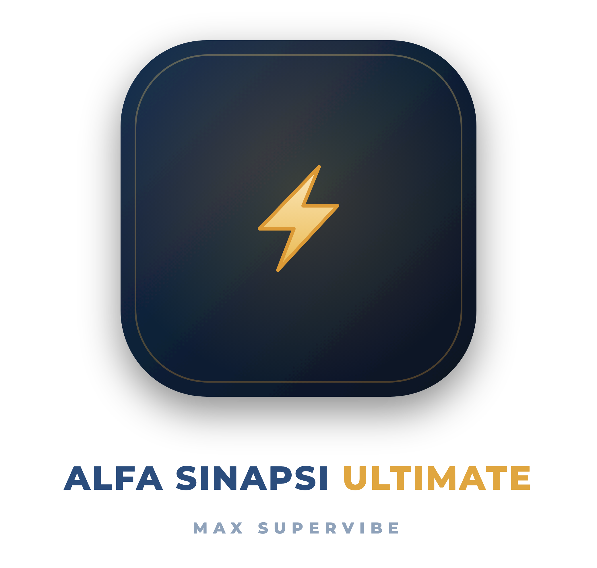
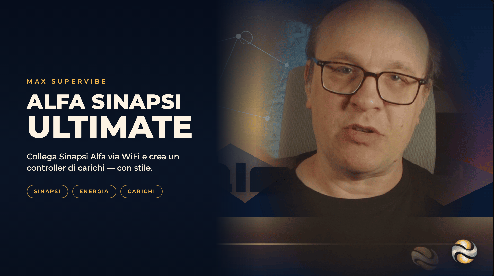
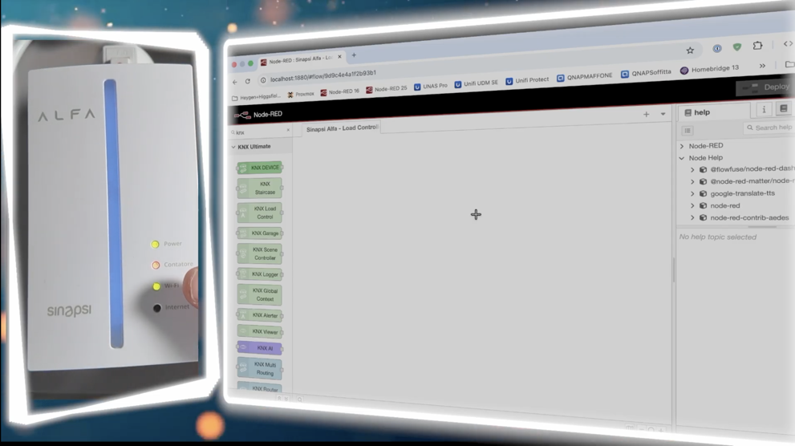

  

## Il nodo per connettere Alfa di Sinapsi a Node-RED

Nodi Node-RED per collegare **Sinapsi Alfa** via WiFi e creare un **controller carichi**.

 
 
 

[![NPM version][npm-version-image]][npm-url]
[![Node.js version][node-version-image]][npm-url]
[![Node-RED Flow Library][flows-image]][flows-url]
[![Docs][docs-image]][docs-url]
[![NPM downloads per month][npm-downloads-month-image]][npm-url]
[![NPM downloads total][npm-downloads-total-image]][npm-url]
[![MIT License][license-image]][license-url]
[![JavaScript Style Guide][standard-image]][standard-url]
[![Youtube][youtube-image]][youtube-url]

  

## Video YouTube

[Guarda il video](https://youtu.be/R-7PZv3iJ2s)

  

## Requisiti

- Un dispositivo Sinapsi Alfa raggiungibile sulla tua rete WiFi

## 📘 Documentazione

La documentazione completa è su **[maxsupervibe.com](https://www.maxsupervibe.com/it/docs/alfasinapsi-ultimate/)**, insieme a quella di tutti gli altri nodi di Max Supervibe.

  <a href="https://www.maxsupervibe.com/it/docs/alfasinapsi-ultimate/">📘 Vai alla documentazione</a>

Novità delle versioni: [CHANGELOG.md](CHANGELOG.md)

[npm-version-image]: https://img.shields.io/npm/v/node-red-contrib-alfasinapsi-ultimate.svg
[npm-url]: https://www.npmjs.com/package/node-red-contrib-alfasinapsi-ultimate
[node-version-image]: https://img.shields.io/node/v/node-red-contrib-alfasinapsi-ultimate.svg
[flows-image]: https://img.shields.io/badge/Node--RED-Flow%20Library-red
[flows-url]: https://flows.nodered.org/node/node-red-contrib-alfasinapsi-ultimate
[docs-image]: https://img.shields.io/badge/docs-documents-blue
[docs-url]: documents/
[npm-downloads-month-image]: https://img.shields.io/npm/dm/node-red-contrib-alfasinapsi-ultimate.svg
[npm-downloads-total-image]: https://img.shields.io/npm/dt/node-red-contrib-alfasinapsi-ultimate.svg
[license-image]: https://img.shields.io/badge/license-MIT-green.svg
[license-url]: https://opensource.org/licenses/MIT
[standard-image]: https://img.shields.io/badge/code%20style-standard-brightgreen.svg
[standard-url]: https://standardjs.com
[youtube-image]: https://img.shields.io/badge/YouTube-Subscribe-red?logo=youtube&logoColor=white
[youtube-url]: https://www.youtube.com/@maxsupervibe
